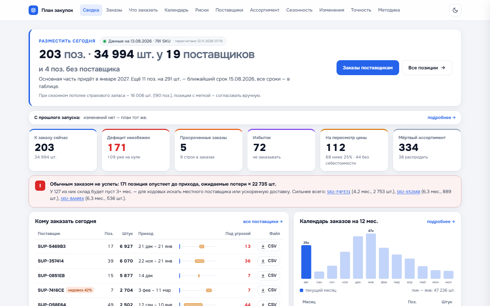
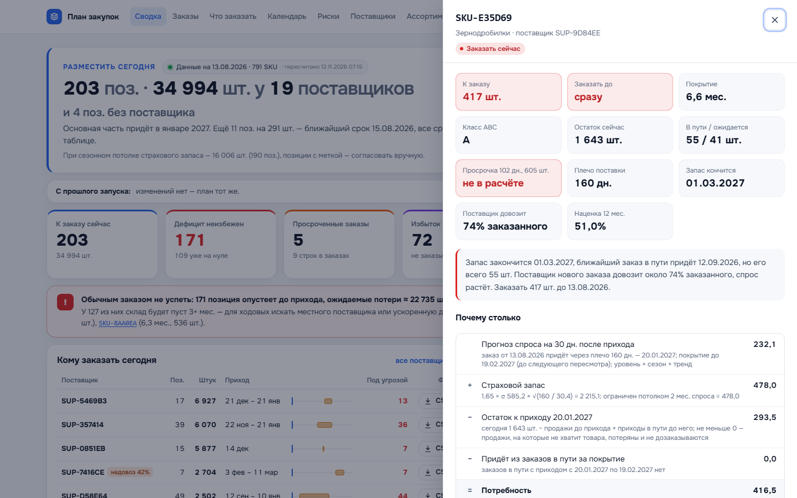

# Планирование закупок импортёра

Система читает выгрузку ERP и отвечает закупщику: что заказать, сколько, когда и где будет дефицит или избыток. Плечо поставки из Китая 4–6 месяцев, поэтому ошибка в заказе видна только через полгода. Задача системы — показать её заранее.

Все цифры считает код. Модель пишет пояснения к готовым числам, а код проверяет, что в тексте нет чужих дат, штук и обещаний.



## Что показывает дашборд

| Вопрос закупщика | Где ответ |
|---|---|
| Какие товары закупить | «Что заказать» — статус по каждому SKU, фильтры по категории, поставщику, ABC |
| Сколько заказать | количество с учётом кратности упаковки и минимальной партии, расшифровка «Почему столько» в карточке SKU |
| На сколько хватит запаса с учётом заказов в пути | покрытие в месяцах и дата обнуления склада, график остатка по месяцам в карточке |
| Когда размещать следующий заказ | «Календарь» на 12 месяцев и «Заказы» — готовые CSV по каждому поставщику |
| Где риск дефицита или избытка | «Риски»: дефицит до прихода, избыток, просроченные заказы, низкая наценка, мёртвый ассортимент |

Ещё есть «Изменения» с прошлого запуска, «Сезонность» категорий, «Поставщики» с долей довоза, «Точность» прогноза на истории и «Методика» с формулами словами.



## Быстрый старт

Нужен Python 3.11 или новее.

```
pip install pandas numpy
python -m zakupki run --data data/raw/share --today 2026-08-13
```

- Выгрузка — шесть CSV в `data/raw/share/` (продажи, остатки, заказы, приходы, справочники товаров и поставщиков). В репозитории лежит обезличенная выгрузка на 13.08.2026, её описание — в `data/raw/share/README.md`. Свежая выгрузка заменяет файлы целиком.
- `--today` — дата выгрузки. Без него дата берётся по последнему заказу или приходу, и CLI предупреждает об этом.
- Результат лежит в `out/`: `dashboard.html` открывается двойным щелчком, рядом `plan.csv`, `risks.csv` и `summary.md`.
- Пояснения пишет модель, если в `.env` заполнены `LLM_BASE_URL`, `LLM_API_KEY` и `LLM_MODEL` (образец — `.env.example`, подходит любой OpenAI-совместимый API). Без них пояснения собираются по шаблону из тех же цифр, расчёт от этого не меняется. `--no-llm` выключает модель.

Остальные параметры: `--min-markup` (порог наценки), `--cover-days` (покрытие после прихода), `--z` (уровень сервиса для всех классов), `--out` (папка результата).

## Как считается

```
выгрузка ERP → проверка данных → спрос → прогноз → поставки → симуляция остатка → план и риски → дашборд
                                                                                        ↓
                                                                    пояснения модели + проверка кодом
```

1. **Проверка данных.** Отбрасываются строки без ключа или даты, с нечисловыми значениями и дубли остатков. Строки позже даты расчёта отрезаются. Всё, что отброшено, попадает в блок «Качество данных». Если не хватает файла или колонки, выводится ошибка по-русски.
2. **Спрос.** Если в месяц остаток был нулевой, продажи там занижены. Такой месяц считается упущенным спросом и в прогноз не попадает.
3. **Прогноз на 36 месяцев:** сезонный индекс категории, уровень SKU и затухающий тренд.
4. **Поставки.** Для каждого поставщика считается плечо и доля довоза. Заказы в пути идут с поправкой на надёжность поставщика. Просрочку до 90 дней ждём через 30 дней, более старую в приход не берём и выносим в риски.
5. **Симуляция остатка** по месяцам. Из неё берётся дата обнуления склада, дата заказа и страховой запас. Страховой запас — по разбросу ошибок прогноза на плече, цель 95% (на истории не проверена), не больше 2 мес. спроса. Он консервативный: у сезонного товара с приходом вне сезона запас может быть крупным. Такие позиции помечены «согласовать вручную», рядом показан сценарий с меньшим запасом.
6. **План.** Количество с кратностью, статус SKU, риски, календарь, заказы по поставщикам.

Подробно с формулами — раздел «Методика» в дашборде.

## Регулярный запуск

Повторный запуск сравнивает результат с прошлым снимком из `out/history/<дата>/` и показывает, что изменилось: новые позиции к заказу, изменения количеств, отмены, сдвиги дат, вход в риск дефицита и выход из него. Если запустить второй раз на тех же данных, `plan.csv` и `risks.csv` совпадут побайтно.

- **Windows:** Планировщик заданий запускает `scripts/run_daily.ps1`, инструкция — в шапке файла. Журнал пишется в `out/run_daily.log`.
- **Linux:** `scripts/cron.example`.
- **GitHub Actions:** `.github/workflows/plan.yml` запускается каждое утро или кнопкой Run workflow. Три шага: **plan** считает план по выгрузке из `data/raw/share/` (новую выгрузку кладут туда коммитом), **deploy** публикует дашборд на GitHub Pages, **notify** присылает сводку в Telegram: сколько разместить сегодня и у каких поставщиков больше всего, где дефицит и просрочки, что изменилось с прошлого запуска, ссылку на дашборд. История между запусками хранится через `actions/cache`.

Дату расчёта передают `-Today` или переменная `DATA_DATE`. Для Telegram нужны секреты репозитория `TELEGRAM_BOT_TOKEN` и `TELEGRAM_CHAT_ID`. Без них шаг notify пропускается. Вручную: `python -m zakupki.notify --url <ссылка>` (по умолчанию берёт `out/summary.md`, `out/plan.csv`, `out/risks.csv`).

## Точность прогноза

Проверено на истории: прогноз строится по данным до 01.08.2025 и сравнивается с фактическими продажами за следующие 12 месяцев. Месяцы, когда товара не было на складе, не учитываются.

| Горизонт | Модель, WAPE | Как год назад (LY) | Среднее за 12 мес. (M12) |
|---|---|---|---|
| 4 мес. | 62% | 71% | 104% |
| 7 мес. | 73% | 78% | 151% |
| 12 мес. | 88% | 90% | 120% |

На плече поставки модель точнее простых правил. Но она завышает спрос в среднем на 29%, сильнее всего — у отдельных категорий. Это видно в разделе «Точность» с разбивкой по категориям.

Пробовал уточнить сезонные индексы: скользящее среднее, медиану по годам, профиль SKU, обрезку выбросов. На одном срезе отдельные варианты выигрывали до 3 п.п., но на двух других срезах проигрывали до 12 п.п. Поэтому оставлен текущий способ.

## Что дальше

- Сезонный страховой и уровень сервиса по ABC. Вариант уже пробовал: на сегодня заказ падал с 35 до 14 тыс. шт. Но дата заказа и повторные заказы должны пересчитываться вместе с запасом, и выигрыш нужно проверить на истории. Поэтому в плане пока консервативный вариант.
- Получить вес и объём у всех SKU (сейчас заполнены у 7). Тогда можно собирать заказ под контейнер.
- Учесть промо и цены: в выгрузке их нет, поэтому прогноз их не видит.

## Как устроен код

| Модуль `zakupki/` | Что делает |
|---|---|
| `config.py` | все пороги и константы, в других модулях чисел нет |
| `data.py` | чтение и проверка CSV, обрезка по дате расчёта |
| `demand.py` | спрос по месяцам, упущенный спрос |
| `forecast.py` | сезонные индексы, уровень, тренд, прогноз |
| `supply.py` | плечо, надёжность поставщиков, заказы в пути, кратность |
| `simulation.py` | остаток по месяцам, страховой запас, дата заказа |
| `plan.py` | количество, статусы, риски, календарь |
| `explain.py` | пояснения модели и их проверка, шаблон при сбое, кэш |
| `history.py` | снимки запусков и сравнение с прошлым |
| `notify.py` | сводка в Telegram после пересчёта |
| `backtest.py` | точность прогноза на истории |
| `dashboard.py`, `report.py`, `cli.py` | дашборд, `summary.md`, команда запуска |

Расчёт детерминирован: дата берётся только из `--today`, сортировки устойчивые. Модель получает готовые числа и пишет текст. Если в тексте чужая дата или число, обещание «избежать дефицита» или вывод о задержке, которого нет в данных, текст отбраковывается и ставится шаблон.

Проект сделан в Claude Code. Правила для него лежат в `CLAUDE.md`, навык пересчёта и разбора плана — в `.claude/skills/plan-zakupok/`, промпты модели — в `zakupki/prompts/`.

## Тесты

```
pip install pytest ruff
python -m ruff check zakupki tests && python -m pytest -q
```

Тесты идут на синтетических данных и в сеть не ходят. `tests/test_real_data.py` дополнительно сверяет итоги на выгрузке из `data/raw/share/`.
